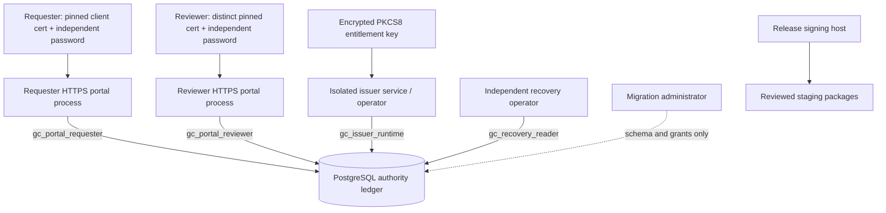
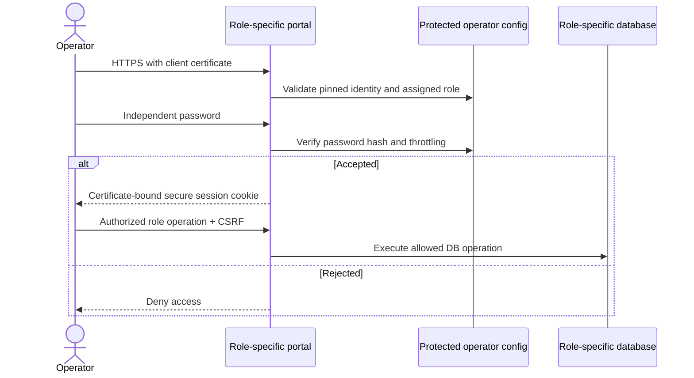
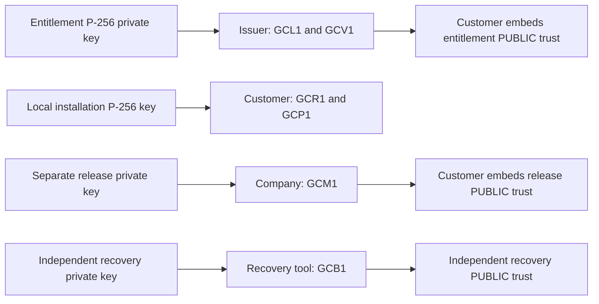

# 01 — System and trust boundaries

Component and deployment architecture. Baseline contains the separate portal, issuer, recovery tool and manifest signer.

[← Authority atlas](README.md) · [Customer visual atlas](https://github.com/VY-Groups/yarp-lb/tree/docs/visual-architecture-atlas/docs/diagrams)

> Authority baseline main: `78b3cbcceafbf08e70d1d319f9318e23665153be`. Candidate integration tests: `a915910a64adb3c6ccddcfa418118d2a38420422` (PR #6). All diagrams show logical software behavior, not production authorization. No real customer data, keys or credentials are shown.

## Company deployment

Requester and reviewer are separate service identities, hostnames and protected configurations; neither process receives the other's DB credentials. Production host isolation must be tested. The legacy file-ledger CLI is a development alternative and must not issue against the same commercial subscriptions.

**Source:** [tools/LicensePortal/README.md](https://github.com/VY-Groups/gatewaycore-license-authority/blob/a915910a64adb3c6ccddcfa418118d2a38420422/tools/LicensePortal/README.md) · [tools/LicenseIssuerWorker/ApprovedJobExecutor.cs](https://github.com/VY-Groups/gatewaycore-license-authority/blob/a915910a64adb3c6ccddcfa418118d2a38420422/tools/LicenseIssuerWorker/ApprovedJobExecutor.cs)

## Operator authentication

Session lifetime is bounded and process-local; restart invalidates sessions. Actual identity independence, secret rotation and phishing-resistant policies are operational decisions.

**Source:** [tools/LicensePortal/README.md](https://github.com/VY-Groups/gatewaycore-license-authority/blob/a915910a64adb3c6ccddcfa418118d2a38420422/tools/LicensePortal/README.md) · [tools/LicensePortal/Program.cs](https://github.com/VY-Groups/gatewaycore-license-authority/blob/a915910a64adb3c6ccddcfa418118d2a38420422/tools/LicensePortal/Program.cs)

## Four distinct key roles

TLS transport credentials are additional, separate identities. No private signing material is transferred into customer packages or web portal processes.

**Source:** [docs/PROTOCOL_BOUNDARY.md](https://github.com/VY-Groups/gatewaycore-license-authority/blob/a915910a64adb3c6ccddcfa418118d2a38420422/docs/PROTOCOL_BOUNDARY.md) · [docs/AUTHORITY_RECOVERY.md](https://github.com/VY-Groups/gatewaycore-license-authority/blob/a915910a64adb3c6ccddcfa418118d2a38420422/docs/AUTHORITY_RECOVERY.md) · [tools/ReleaseManifestSigner/ReleaseManifestBuilder.cs](https://github.com/VY-Groups/gatewaycore-license-authority/blob/a915910a64adb3c6ccddcfa418118d2a38420422/tools/ReleaseManifestSigner/ReleaseManifestBuilder.cs)

