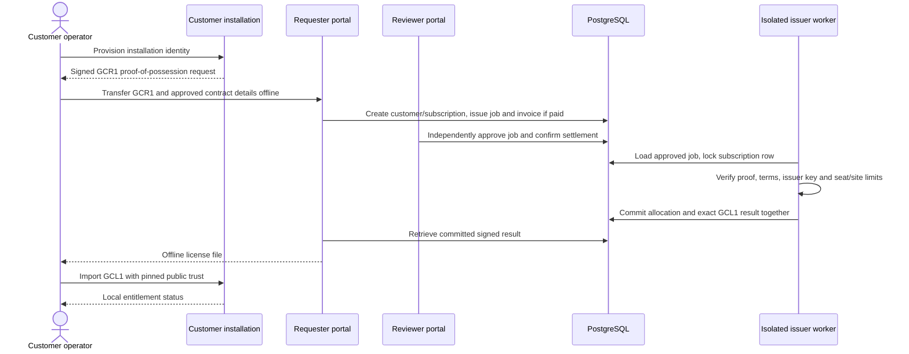
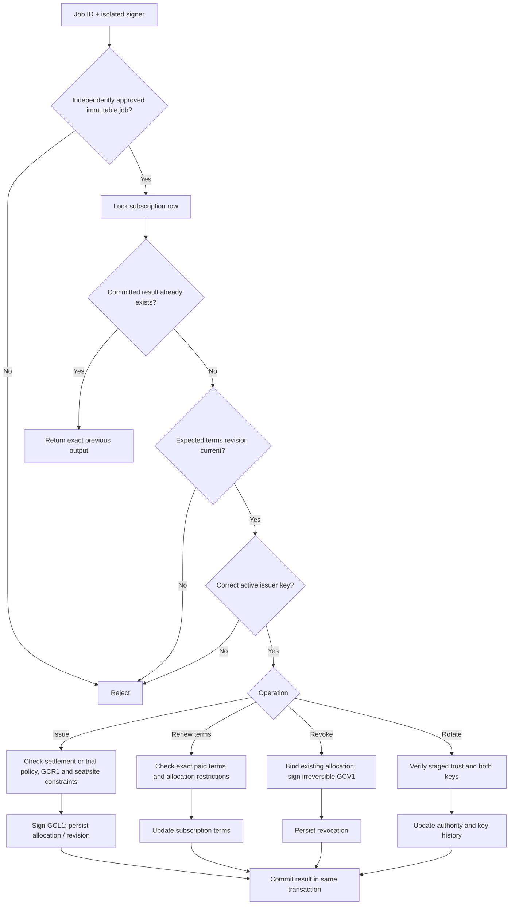
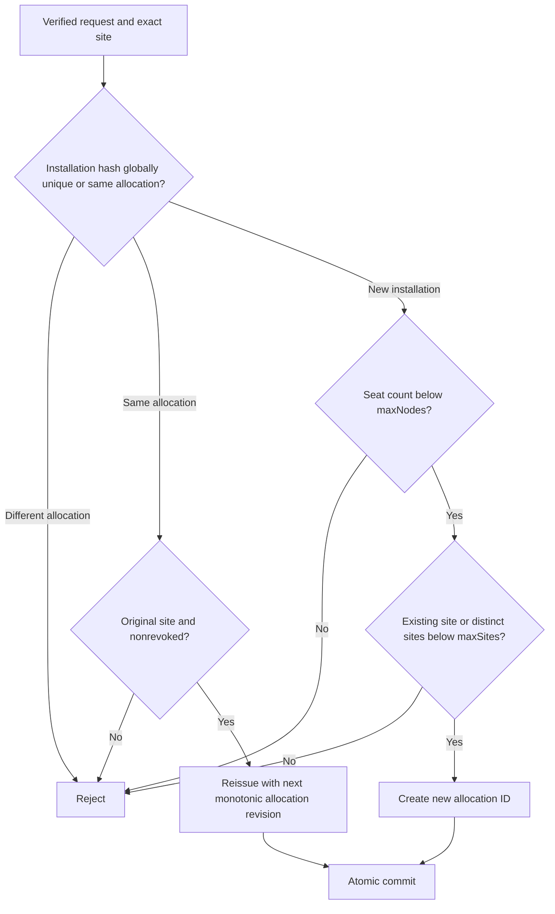
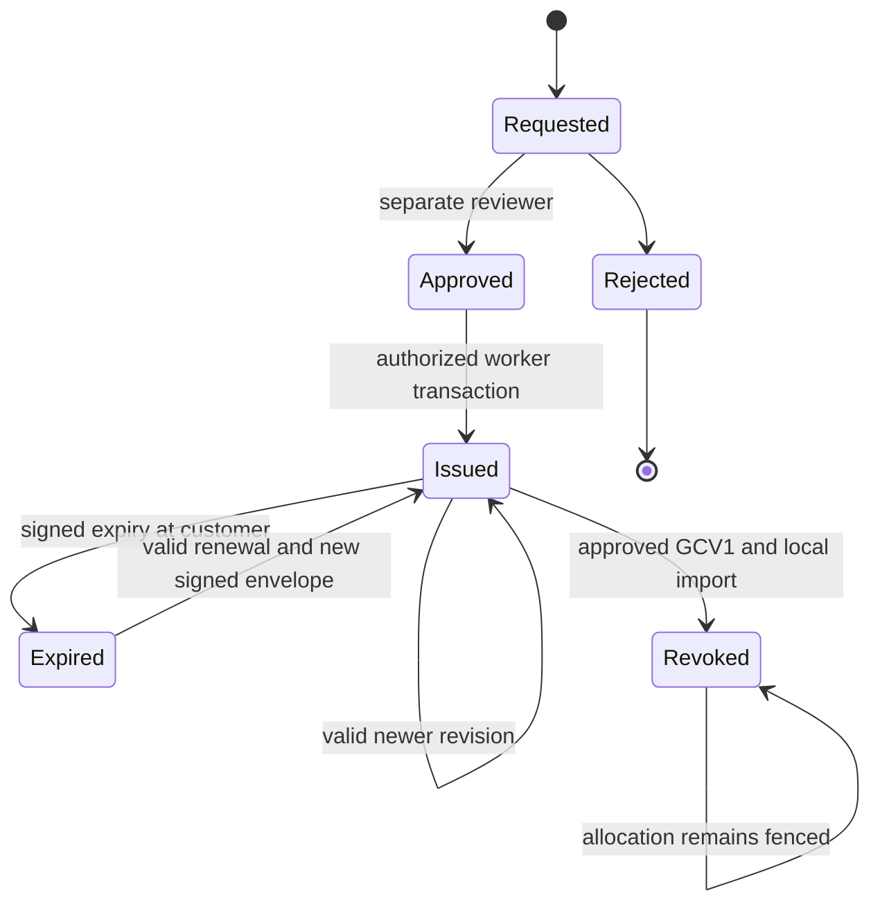

# 02 — Issuance and license lifecycle

End-to-end offline activation and transactional issuance.

[← Authority atlas](README.md) · [Customer visual atlas](https://github.com/VY-Groups/yarp-lb/tree/docs/visual-architecture-atlas/docs/diagrams)

> Authority baseline main: `78b3cbcceafbf08e70d1d319f9318e23665153be`. Candidate integration tests: `a915910a64adb3c6ccddcfa418118d2a38420422` (PR #6). All diagrams show logical software behavior, not production authorization. No real customer data, keys or credentials are shown.

## Activation sequence

New PostgreSQL issuer GCL1 uses schema 2 with exact allocated site. Schema 1 remains compatible for standalone usage; fleet requires site-bound proof. No network call by the customer runtime.

**Source:** [tools/LicenseIssuerWorker/ApprovedJobExecutor.cs](https://github.com/VY-Groups/gatewaycore-license-authority/blob/a915910a64adb3c6ccddcfa418118d2a38420422/tools/LicenseIssuerWorker/ApprovedJobExecutor.cs) · [docs/PROTOCOL_BOUNDARY.md](https://github.com/VY-Groups/gatewaycore-license-authority/blob/a915910a64adb3c6ccddcfa418118d2a38420422/docs/PROTOCOL_BOUNDARY.md)

## Worker decision and transaction

Failure rolls back the database transaction; do not return an uncommitted signature as a completed issuance. A committed job retry returns the recorded result, including a null envelope for terms/rotation operations where applicable.

**Source:** [tools/LicenseIssuerWorker/ApprovedJobExecutor.cs](https://github.com/VY-Groups/gatewaycore-license-authority/blob/a915910a64adb3c6ccddcfa418118d2a38420422/tools/LicenseIssuerWorker/ApprovedJobExecutor.cs)

## Node and site allocation

Revoked allocations retain their consumed seat; no automatic reassignment or site transfer. Commercial offline software cannot conclusively detect all privileged cloning of an installation.

**Source:** [tools/LicenseIssuerWorker/ApprovedJobExecutor.cs](https://github.com/VY-Groups/gatewaycore-license-authority/blob/a915910a64adb3c6ccddcfa418118d2a38420422/tools/LicenseIssuerWorker/ApprovedJobExecutor.cs) · [tools/LicensePortal/schema.sql](https://github.com/VY-Groups/gatewaycore-license-authority/blob/a915910a64adb3c6ccddcfa418118d2a38420422/tools/LicensePortal/schema.sql)

## License lifecycle

Authority revocation and customer revocation are distinct events: a signed GCV1 must actually reach and be imported by the offline installation. No immediate remote revocation promise.

**Source:** [docs/PROTOCOL_BOUNDARY.md](https://github.com/VY-Groups/gatewaycore-license-authority/blob/a915910a64adb3c6ccddcfa418118d2a38420422/docs/PROTOCOL_BOUNDARY.md) · [tools/LicensePortal/README.md](https://github.com/VY-Groups/gatewaycore-license-authority/blob/a915910a64adb3c6ccddcfa418118d2a38420422/tools/LicensePortal/README.md)

