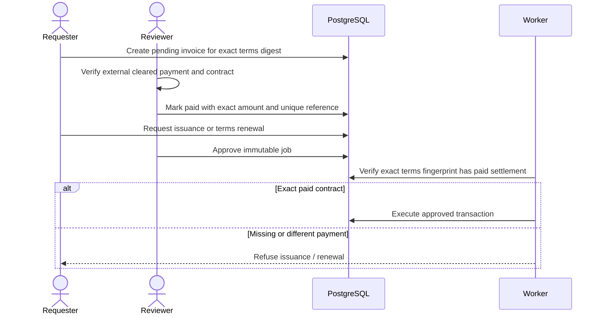
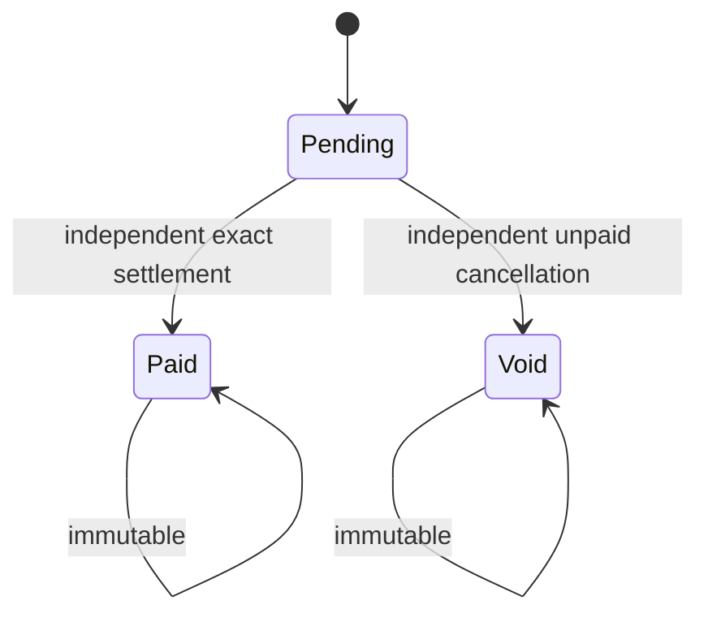
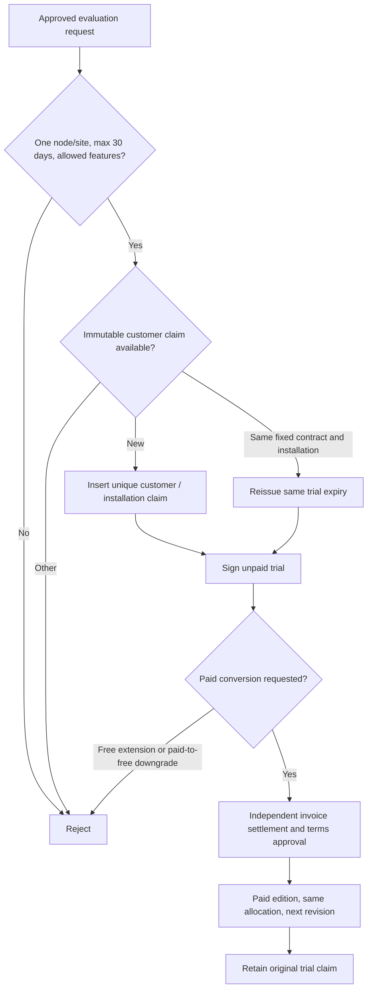

# 03 — Billing and evaluation

Manual, independently reviewed payment settlement. No payment gateway or tax/accounting automation is asserted.

[← Authority atlas](README.md) · [Customer visual atlas](https://github.com/VY-Groups/yarp-lb/tree/docs/visual-architecture-atlas/docs/diagrams)

> Authority baseline main: `78b3cbcceafbf08e70d1d319f9318e23665153be`. Candidate integration tests: `a915910a64adb3c6ccddcfa418118d2a38420422` (PR #6). All diagrams show logical software behavior, not production authorization. No real customer data, keys or credentials are shown.

## Paid issuance and renewal

A paid unchanged contract may cover multiple approved seats. Key rotation alone does not change the terms fingerprint; revocation/rotation do not depend on payment. Actual bank/provider verification, refunds, tax invoices and pricing require external processes.

**Source:** [docs/COMMERCIAL_BILLING.md](https://github.com/VY-Groups/gatewaycore-license-authority/blob/a915910a64adb3c6ccddcfa418118d2a38420422/docs/COMMERCIAL_BILLING.md) · [tools/LicensePortal/migration-003-billing.sql](https://github.com/VY-Groups/gatewaycore-license-authority/blob/a915910a64adb3c6ccddcfa418118d2a38420422/tools/LicensePortal/migration-003-billing.sql)

## Invoice states

No payment reference reuse or silent edit of paid records. Amounts are stored in currency minor units.

**Source:** [tools/LicensePortal/migration-003-billing.sql](https://github.com/VY-Groups/gatewaycore-license-authority/blob/a915910a64adb3c6ccddcfa418118d2a38420422/tools/LicensePortal/migration-003-billing.sql)

## Evaluation and conversion

Defaults are provisional owner policy: one trial per customer identifier, one site/node, maximum 30 days, L7 required and TLS/monitoring optional. Different customer identifiers need external business identity controls; this is not person-level fraud prevention.

**Source:** [tools/LicensePortal/migration-004-evaluation.sql](https://github.com/VY-Groups/gatewaycore-license-authority/blob/a915910a64adb3c6ccddcfa418118d2a38420422/tools/LicensePortal/migration-004-evaluation.sql) · [tools/AuthorityContracts/Subscription.cs](https://github.com/VY-Groups/gatewaycore-license-authority/blob/a915910a64adb3c6ccddcfa418118d2a38420422/tools/AuthorityContracts/Subscription.cs) · [tools/LicenseIssuerWorker/ApprovedJobExecutor.cs](https://github.com/VY-Groups/gatewaycore-license-authority/blob/a915910a64adb3c6ccddcfa418118d2a38420422/tools/LicenseIssuerWorker/ApprovedJobExecutor.cs)

