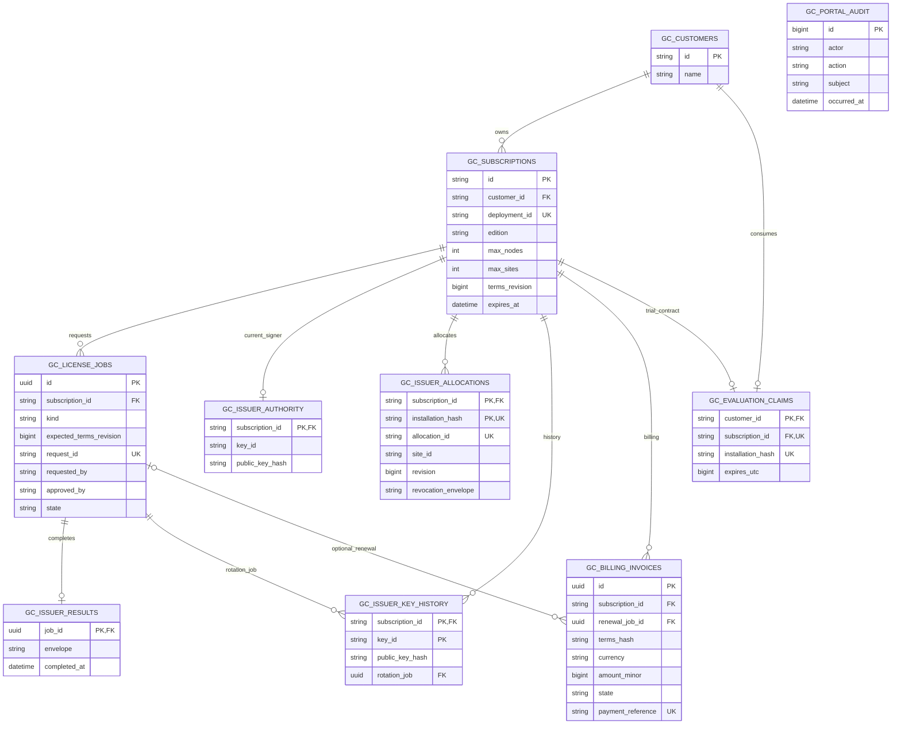
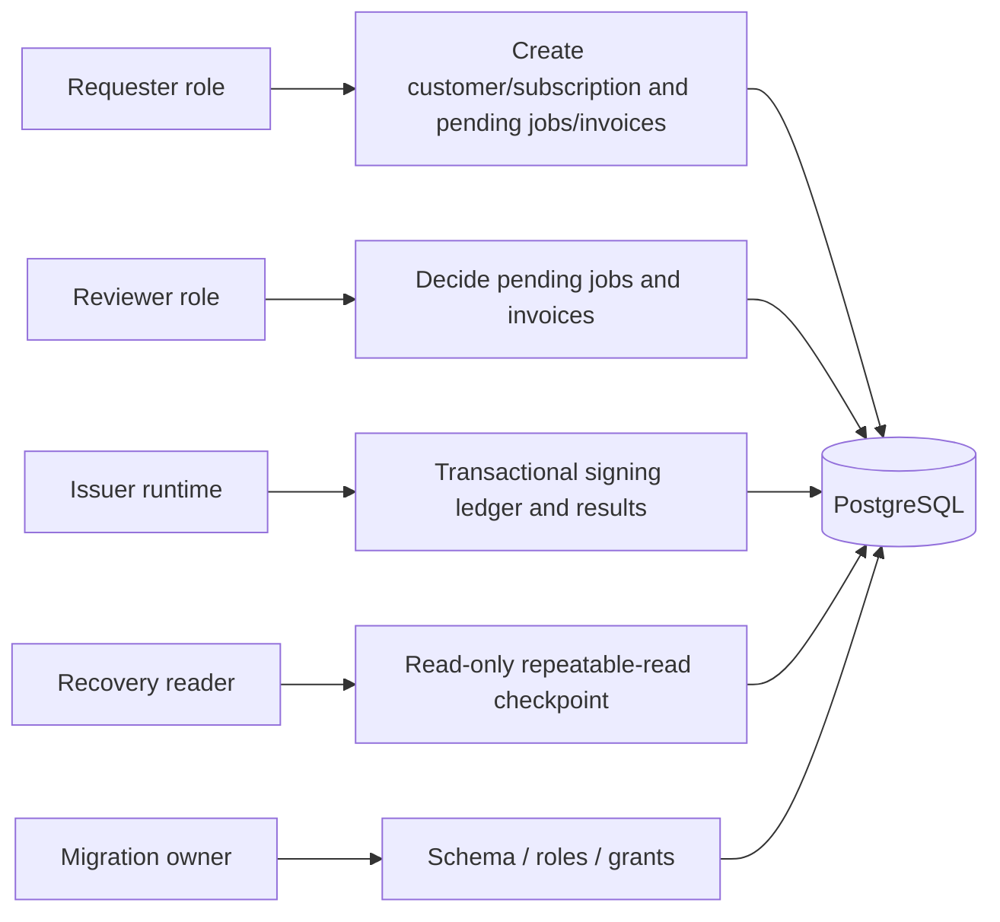
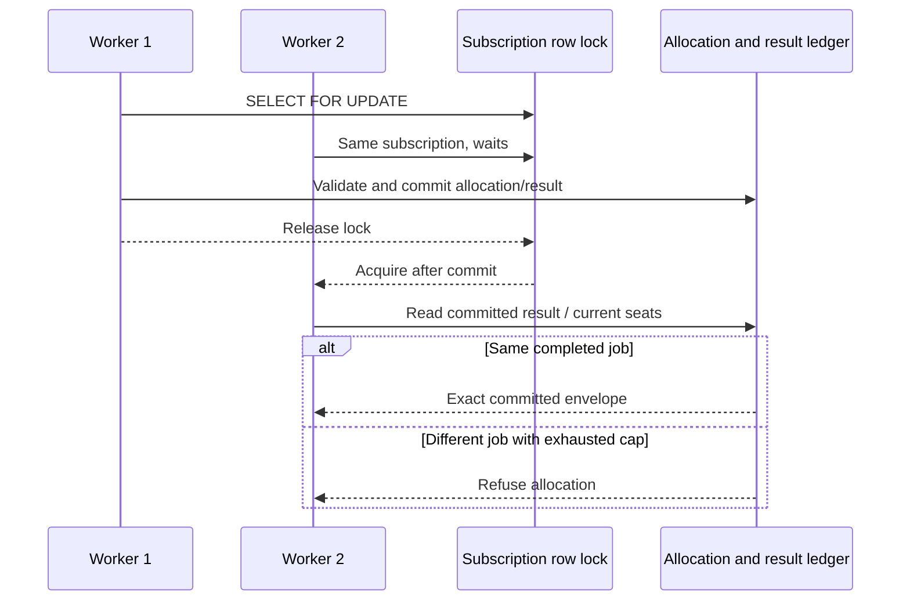

# 04 — PostgreSQL ledger and permission model

Logical ER diagram derived from schema.sql and migrations 002–004. Selected fields only; see SQL for exact constraints.

[← Authority atlas](README.md) · [Customer visual atlas](https://github.com/VY-Groups/yarp-lb/tree/docs/visual-architecture-atlas/docs/diagrams)

> Authority baseline main: `78b3cbcceafbf08e70d1d319f9318e23665153be`. Candidate integration tests: `a915910a64adb3c6ccddcfa418118d2a38420422` (PR #6). All diagrams show logical software behavior, not production authorization. No real customer data, keys or credentials are shown.

## Entity relationship diagram

Audit subjects are textual, not an inferred foreign key. The diagram omits many fields, triggers, CHECK constraints and indexes; SQL migrations are authoritative.

**Source:** [tools/LicensePortal/schema.sql](https://github.com/VY-Groups/gatewaycore-license-authority/blob/a915910a64adb3c6ccddcfa418118d2a38420422/tools/LicensePortal/schema.sql) · [tools/LicensePortal/migration-002-authority-rotation.sql](https://github.com/VY-Groups/gatewaycore-license-authority/blob/a915910a64adb3c6ccddcfa418118d2a38420422/tools/LicensePortal/migration-002-authority-rotation.sql) · [tools/LicensePortal/migration-003-billing.sql](https://github.com/VY-Groups/gatewaycore-license-authority/blob/a915910a64adb3c6ccddcfa418118d2a38420422/tools/LicensePortal/migration-003-billing.sql) · [tools/LicensePortal/migration-004-evaluation.sql](https://github.com/VY-Groups/gatewaycore-license-authority/blob/a915910a64adb3c6ccddcfa418118d2a38420422/tools/LicensePortal/migration-004-evaluation.sql)

## Role separation

No runtime role is the schema owner. Requester and issuer cannot approve jobs; portal roles do not write issuer signing state. Recovery identity has no mutation privileges. A privileged DB owner can still change data, so external checkpoint protection matters.

**Source:** [tools/LicensePortal/runtime-grants.sql](https://github.com/VY-Groups/gatewaycore-license-authority/blob/a915910a64adb3c6ccddcfa418118d2a38420422/tools/LicensePortal/runtime-grants.sql) · [tools/AuthorityRecovery/recovery-grants.sql](https://github.com/VY-Groups/gatewaycore-license-authority/blob/a915910a64adb3c6ccddcfa418118d2a38420422/tools/AuthorityRecovery/recovery-grants.sql) · [tools/LicensePortal/README.md](https://github.com/VY-Groups/gatewaycore-license-authority/blob/a915910a64adb3c6ccddcfa418118d2a38420422/tools/LicensePortal/README.md)

## Concurrent issuance and idempotence

Across different evaluation subscriptions, the unique customer claim serializes the first trial; database uniqueness also protects global installation binding.

**Source:** [tools/LicenseIssuerWorker/ApprovedJobExecutor.cs](https://github.com/VY-Groups/gatewaycore-license-authority/blob/a915910a64adb3c6ccddcfa418118d2a38420422/tools/LicenseIssuerWorker/ApprovedJobExecutor.cs) · [tests/PostgresAcceptance/Program.cs](https://github.com/VY-Groups/gatewaycore-license-authority/blob/a915910a64adb3c6ccddcfa418118d2a38420422/tests/PostgresAcceptance/Program.cs)

