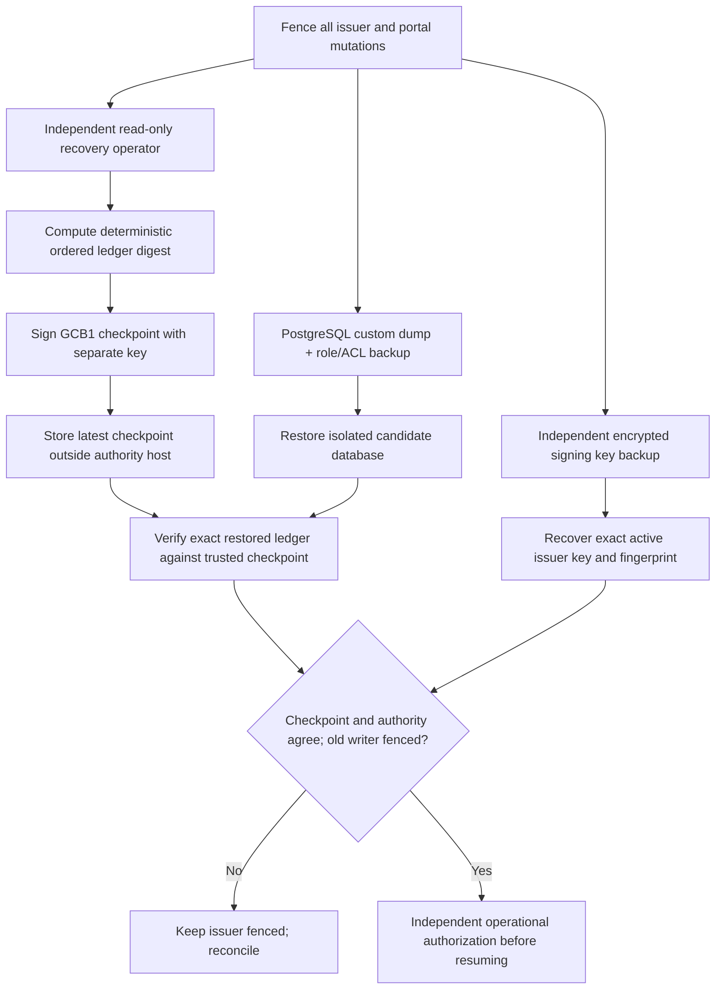
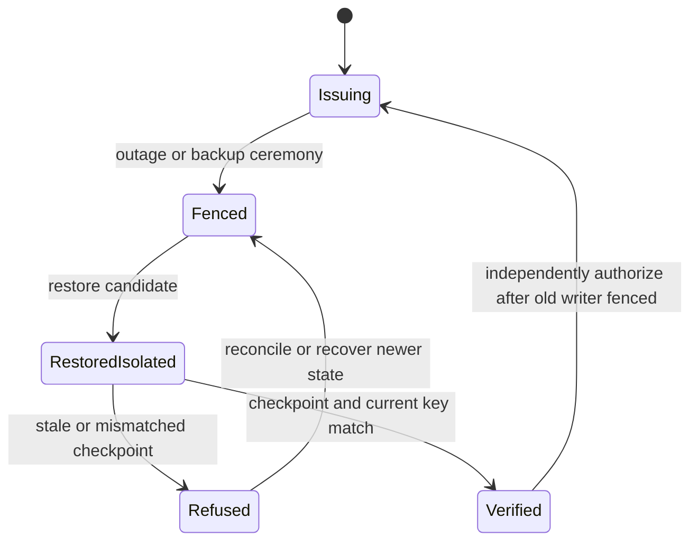

# 05 — Key rotation, ledger recovery and HA limits

Separate signing-key, database and release-key trust boundaries.

[← Authority atlas](README.md) · [Customer visual atlas](https://github.com/VY-Groups/yarp-lb/tree/docs/visual-architecture-atlas/docs/diagrams)

> Authority baseline main: `78b3cbcceafbf08e70d1d319f9318e23665153be`. Candidate integration tests: `a915910a64adb3c6ccddcfa418118d2a38420422` (PR #6). All diagrams show logical software behavior, not production authorization. No real customer data, keys or credentials are shown.

## Entitlement key rotation
```mermaid
sequenceDiagram
actor A as Requester
actor B as Reviewer
participant C as Customer trust release
participant D as PostgreSQL
participant W as Isolated issuer
A->>C: Stage old + new public trust
A->>D: Request rotation with new key fingerprint
B->>D: Independently approve staged-trust assertion
W->>W: Prove possession of current and new private keys
W->>D: Verify approved fingerprint and current authority
W->>D: Atomically switch signer; update history and terms revision
D-->>W: Commit
Note over C,W: Old public trust remains until existing entitlements and revocations are migrated
```

Staged trust is an operator acknowledgement, not a cryptographic attestation of every offline node. Old signer cannot issue fresh jobs after rotation; stale approvals fail closed. Loss/compromise of old key needs a separate recovery plan.

**Source:** [tools/LicensePortal/README.md](https://github.com/VY-Groups/gatewaycore-license-authority/blob/a915910a64adb3c6ccddcfa418118d2a38420422/tools/LicensePortal/README.md) · [tools/LicensePortal/migration-002-authority-rotation.sql](https://github.com/VY-Groups/gatewaycore-license-authority/blob/a915910a64adb3c6ccddcfa418118d2a38420422/tools/LicensePortal/migration-002-authority-rotation.sql) · [tools/LicenseIssuerWorker/ApprovedJobExecutor.cs](https://github.com/VY-Groups/gatewaycore-license-authority/blob/a915910a64adb3c6ccddcfa418118d2a38420422/tools/LicenseIssuerWorker/ApprovedJobExecutor.cs)

## Backup and recovery ceremony


Recovery uses ten ledger tables (customers, subscriptions, jobs, signer authority, allocations, results, key history, invoices, evaluation claims, audit). GCB1 protects a supplied checkpoint; its freshness depends on independent custody. It does not perform automatic database promotion or consensus.

**Source:** [docs/AUTHORITY_RECOVERY.md](https://github.com/VY-Groups/gatewaycore-license-authority/blob/a915910a64adb3c6ccddcfa418118d2a38420422/docs/AUTHORITY_RECOVERY.md) · [tools/AuthorityRecovery/LedgerCheckpoint.cs](https://github.com/VY-Groups/gatewaycore-license-authority/blob/a915910a64adb3c6ccddcfa418118d2a38420422/tools/AuthorityRecovery/LedgerCheckpoint.cs)

## Authority failure and restore boundaries


Real pg_dump/pg_restore CI is development evidence for logical recovery. PostgreSQL HA/WAL PITR after checkpoint, production RTO/RPO, immutable audit and physical independent-host acceptance remain separate.

**Source:** [docs/AUTHORITY_RECOVERY.md](https://github.com/VY-Groups/gatewaycore-license-authority/blob/a915910a64adb3c6ccddcfa418118d2a38420422/docs/AUTHORITY_RECOVERY.md) · [tests/PostgresAcceptance/RecoveryAcceptance.cs](https://github.com/VY-Groups/gatewaycore-license-authority/blob/a915910a64adb3c6ccddcfa418118d2a38420422/tests/PostgresAcceptance/RecoveryAcceptance.cs)

