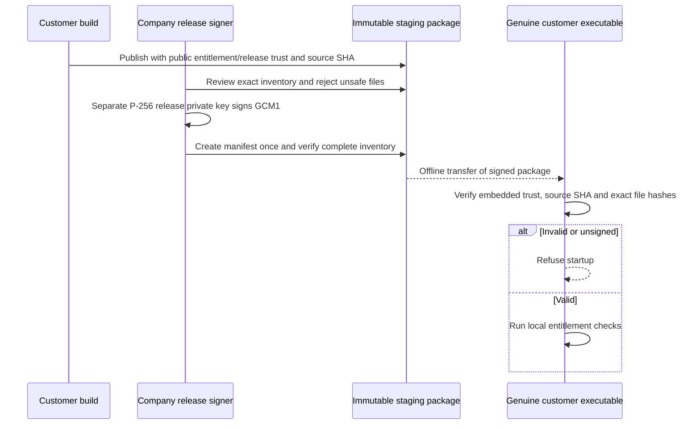
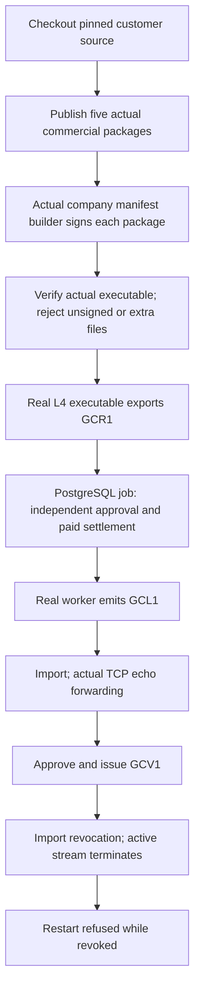
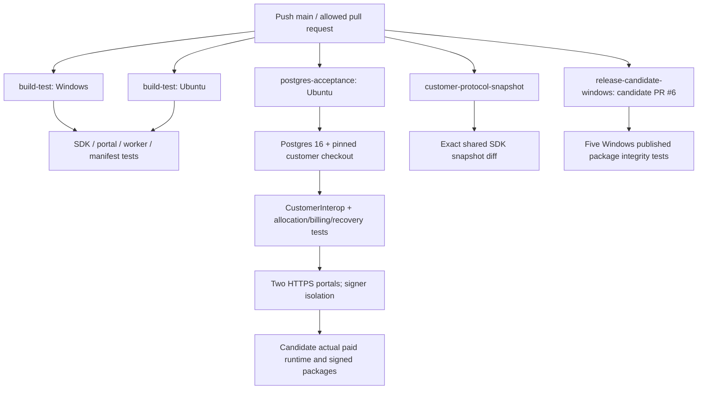
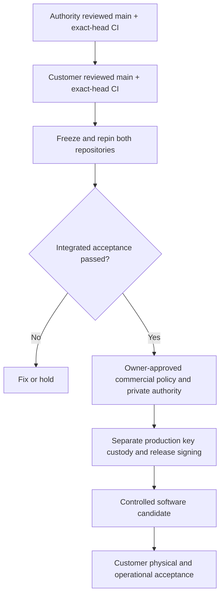

# 06 — Release signing, interoperability and CI

Baseline manifest signer and candidate actual-binary integration tests.

[← Authority atlas](README.md) · [Customer visual atlas](https://github.com/VY-Groups/yarp-lb/tree/docs/visual-architecture-atlas/docs/diagrams)

> Authority baseline main: `78b3cbcceafbf08e70d1d319f9318e23665153be`. Candidate integration tests: `a915910a64adb3c6ccddcfa418118d2a38420422` (PR #6). All diagrams show logical software behavior, not production authorization. No real customer data, keys or credentials are shown.

## Independent release signing

No key or license is included in the release inventory. GCM1 is not an OS code signature or trusted timestamp; operator must keep staging private and immutable.

**Source:** [tools/ReleaseManifestSigner/ReleaseManifestBuilder.cs](https://github.com/VY-Groups/gatewaycore-license-authority/blob/a915910a64adb3c6ccddcfa418118d2a38420422/tools/ReleaseManifestSigner/ReleaseManifestBuilder.cs) · [README.md](https://github.com/VY-Groups/gatewaycore-license-authority/blob/a915910a64adb3c6ccddcfa418118d2a38420422/README.md)

## Integrated paid runtime acceptance — PR #6 candidate

CI uses ephemeral signing keys and synthetic records. No artifact is promoted to a customer release. Other engines' runtime traffic acceptance is covered separately; this candidate specifically exercises paid runtime and revocation with L4.

**Source:** [docs/INTEGRATED_COMMERCIAL_CANDIDATE.md](https://github.com/VY-Groups/gatewaycore-license-authority/blob/a915910a64adb3c6ccddcfa418118d2a38420422/docs/INTEGRATED_COMMERCIAL_CANDIDATE.md) · [tests/CommercialCandidate/Program.cs](https://github.com/VY-Groups/gatewaycore-license-authority/blob/a915910a64adb3c6ccddcfa418118d2a38420422/tests/CommercialCandidate/Program.cs)

## Authority CI job graph

Baseline four jobs include matrix instances; candidate adds Windows package acceptance and expands PostgreSQL job. These are parallel independent jobs, not a sequential cross-job dependency. The candidate must be repinned to the final merged customer source before release.

**Source:** [.github/workflows/authority-ci.yml](https://github.com/VY-Groups/gatewaycore-license-authority/blob/a915910a64adb3c6ccddcfa418118d2a38420422/.github/workflows/authority-ci.yml)

## Commercial promotion gates

No real billing, production signing, external provider, physical HA or legal certification is performed by diagram documentation.

**Source:** [docs/INTEGRATED_COMMERCIAL_CANDIDATE.md](https://github.com/VY-Groups/gatewaycore-license-authority/blob/a915910a64adb3c6ccddcfa418118d2a38420422/docs/INTEGRATED_COMMERCIAL_CANDIDATE.md) · [docs/AUTHORITY_RECOVERY.md](https://github.com/VY-Groups/gatewaycore-license-authority/blob/a915910a64adb3c6ccddcfa418118d2a38420422/docs/AUTHORITY_RECOVERY.md)

