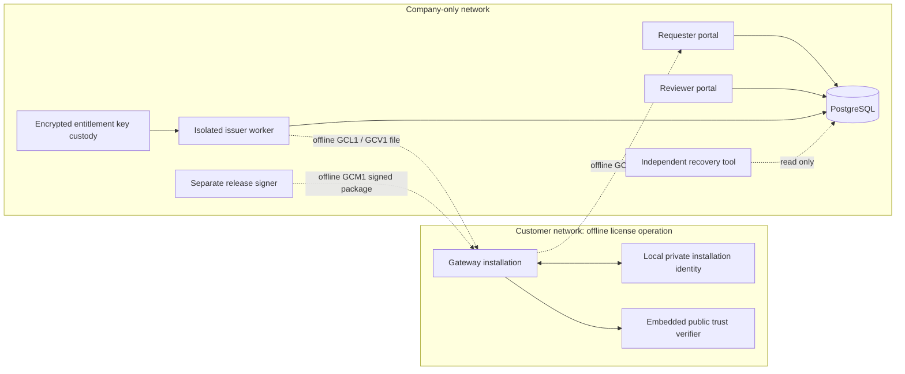

# GatewayCore License Authority — visual atlas

Company-side repository. It is temporarily public for development only; make it private and independently provision isolated services before using commercial material. No production signing keys, customer records, payment data or database backups belong in Git.

**Source baseline:** [merged main `78b3cbc`](https://github.com/VY-Groups/gatewaycore-license-authority/tree/78b3cbcceafbf08e70d1d319f9318e23665153be). The integrated candidate workflow is documented separately from [PR #6 `a915910`](https://github.com/VY-Groups/gatewaycore-license-authority/tree/a915910a64adb3c6ccddcfa418118d2a38420422); its presence is not a CI pass or release authorization.

## Reading order

| Page | Scope |
|---|---|
| [01 — System and trust boundaries](01-system.md) | Company/customer separation, key ownership, portal role isolation, deployment |
| [02 — Issuance and license lifecycle](02-issuance.md) | GCR1/GCL1/GCV1, worker transaction, allocation limits, renewal, revocation |
| [03 — Billing and evaluation](03-billing.md) | Manual settlement, exact terms, paid conversion, concurrent trials |
| [04 — PostgreSQL and permissions](04-database.md) | Data model, roles, transaction isolation, immutable decisions |
| [05 — Key rotation and recovery](05-recovery.md) | Authority rotation, GCB1 checkpoint, backup/restore and recovery fencing |
| [06 — Release, interoperability and CI](06-delivery.md) | GCM1 release signing, customer integration, job graphs, approval and promotion |
| [Customer visual atlas](https://github.com/VY-Groups/yarp-lb/tree/docs/visual-architecture-atlas/docs/diagrams) | L7/L4/GSLB, customer runtime, distributed controller fencing and physical acceptance |

## One-picture system boundary

The dotted cross-boundary arrows are **manual/operator-mediated file exchange**, not direct network calls or mandatory licensing telemetry. The company database is not the customer application database, and company recovery authority is not the customer's etcd fleet controller lock.

## Status legend

- **Implemented baseline:** present in the merged authority source snapshot.
- **Candidate:** integrated published-binary CI in PR #6; independent exact-head acceptance still required.
- **External gate:** actual payment confirmation, production TLS/host isolation, key custody, backup freshness, operational failover, legal/commercial terms, physical acceptance.

Keep these diagrams and source pins updated when the implementation changes.
